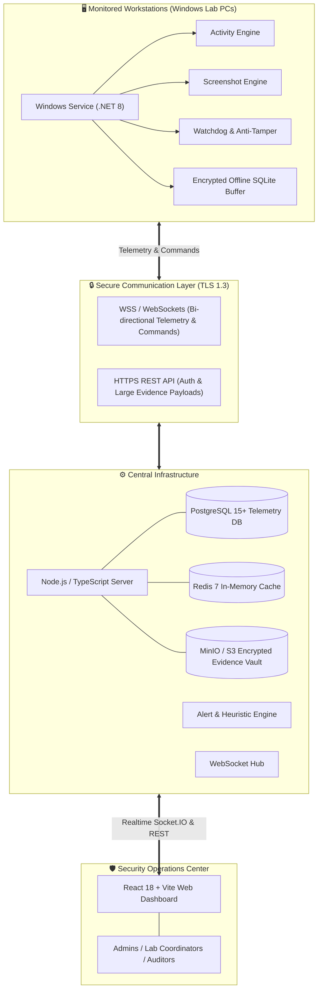

<div align="center">

# 🛡️ SentinelWatch | CyberGuard PC Monitoring System
### *Enterprise-Grade Real-Time Endpoint Security, Forensics & Monitoring Platform for Academic & Enterprise Labs*

[](https://github.com/fareedahamed0425-code/Monitor)
[](https://github.com/fareedahamed0425-code/Monitor/releases)
[](https://opensource.org/licenses/MIT)
[](https://github.com/fareedahamed0425-code/Monitor)
[](https://github.com/fareedahamed0425-code/Monitor)

<br/>

[](https://dotnet.microsoft.com/)
[](https://nodejs.org/)
[](https://www.typescriptlang.org/)
[](https://react.dev/)
[](https://vitejs.dev/)
[](https://mui.com/)
[](https://www.postgresql.org/)
[](https://redis.io/)
[](https://min.io/)
[](https://socket.io/)

<br/>

[Explore Features](#-key-features) •
[Architecture](#-system-architecture) •
[Quick Start](#-quick-start) •
[Endpoint Client](#-windows-endpoint-agent) •
[Server Backend](#-central-server--api) •
[Dashboard](#-soc-admin-dashboard) •
[Security Model](#-security--anti-tamper-architecture)

<br/>

---

</div>

## 📌 Overview

**SentinelWatch / CollegeMonitor** is a distributed, high-performance cyber security monitoring and digital forensics solution engineered for educational institutions, research computer labs, and enterprise networks. It combines a low-overhead, resilient C# .NET Windows endpoint service with a high-throughput Node.js/TypeScript telemetry server and a Material-UI powered Security Operations Center (SOC) dashboard.

The system empowers network administrators and security teams with live activity tracking, automated threat heuristics, keyword and process blacklisting, anti-tamper stealth mechanisms, instant screenshot evidence capture, and end-to-end encrypted telemetry ingestion.

---

## ✨ Key Features

### 🖥️ 1. Stealth Endpoint Agent (`.NET 8 / C#`)
* **Background Windows Service**: Runs as a low-footprint background service with optional process masking (`WinSysUpdate`).
* **Self-Healing Watchdog**: Dual-process guardian mechanism that ensures the monitoring agent cannot be terminated from Task Manager.
* **Granular Process & Window Surveillance**: Tracks active process execution, title bars, and time spent per window with millisecond accuracy.
* **Keyword Detection Heuristics**: Real-time regex engine detecting suspicious activities (e.g., *mimikatz*, *reverse shell*, *keylogger*, *cracks*, *.onion* domains).
* **Hardware & Peripheral Auditing**: Detects USB insertions/ejections, network adapter fluctuations, and MAC address changes.
* **Offline Resilient Queueing**: Encrypted SQLite local cache that buffers telemetry during network interruptions and replays securely once restored.
* **Automated Evidence Capture**: High-definition, multi-monitor screenshot capture triggered by suspicious rules or periodic schedules.

### 🌐 2. High-Performance Central Server (`Node.js / Express / Socket.IO`)
* **Full-Duplex Command & Control (C2)**: WebSocket hub for instant command dispatch (remote screenshot, process kill, policy broadcast, lock station).
* **Automated Risk Scoring Engine**: Calculates live threat scores for each user and workstation based on weighted telemetry rules.
* **Secure Evidence Vault**: S3/MinIO compatible object store for compressed and encrypted visual evidence and audit logs.
* **Role-Based Access Control (RBAC)**: Fine-grained permissions with JWT authentication supporting Superadmins, Lab Instructors, and Auditors.
* **High Availability Ready**: Backed by PostgreSQL for relational telemetry and Redis for live session caching and message broadcasting.

### 📊 3. Modern SOC React Dashboard (`React 18 / TypeScript / MUI`)
* **Real-Time Fleet Telemetry**: Live station statuses, active users, network health, and instant CPU/Memory gauges.
* **Interactive Threat Triage**: Filter alerts by severity (`CRITICAL`, `HIGH`, `MEDIUM`, `LOW`), with single-click incident resolution workflows.
* **Live Evidence Gallery**: Forensic screenshot viewer with zoom, full-screen playback, metadata overlays, and secure export.
* **Dynamic Policy Management**: Push global or lab-specific policies (blocked apps, banned URLs, trigger phrases) without client restarts.
* **Audit & Compliance Reporting**: Generate exportable PDF and CSV compliance reports for administrative audits.

---

## 🏗️ System Architecture



---

## 📂 Project Structure

```text
cyber-tool-monitoring/
├── 📁 client/                        # Windows Endpoint Agent (.NET 8 C#)
│   └── 📁 src/
│       ├── 📄 Program.cs             # Service host configuration & dependency injection
│       ├── 📄 appsettings.json       # Agent configuration, thresholds & service metadata
│       ├── 📁 Services/
│       │   ├── 📄 ActivityMonitorService.cs  # Window, process, USB & keyword monitoring
│       │   ├── 📄 ScreenshotService.cs       # Multi-monitor visual evidence capture
│       │   ├── 📄 WatchdogService.cs         # Anti-kill watchdog & integrity monitor
│       │   ├── 📄 LocalStorageService.cs     # Encrypted SQLite offline queue
│       │   ├── 📄 NetworkService.cs          # WebSocket client & REST telemetry sync
│       │   └── 📄 StealthService.cs          # Process masking and evasion controls
│       └── 📁 Configuration/
│
├── 📁 server/                        # Central Telemetry & API Server (Node.js/TS)
│   └── 📁 src/
│       ├── 📄 app.ts                 # Express REST API, security middleware & routes
│       ├── 📁 alerts/
│       │   └── 📄 AlertEngine.ts     # Risk calculation & rule heuristic engine
│       ├── 📁 websocket/
│       │   ├── 📄 WebSocketHub.ts    # Bi-directional client connection manager
│       │   └── 📄 MessageHandlers.ts # Real-time command & payload dispatchers
│       ├── 📁 models/                # PostgreSQL schema, migrations & repositories
│       ├── 📁 storage/               # MinIO/S3 object storage adapter
│       └── 📁 auth/                  # JWT, password hashing & RBAC middleware
│
├── 📁 dashboard/                     # Security Operations Dashboard (React 18 + MUI)
│   └── 📁 src/
│       ├── 📄 App.tsx                # Client-side router & layout wrappers
│       ├── 📁 pages/                 # Full SOC Views (Dashboard, Alerts, Workstations,
│       │                             # Evidence Vault, Policies, Reports, Audit Logs)
│       ├── 📁 contexts/              # AuthContext, SocketContext
│       ├── 📁 components/            # Data grids, charts, modal viewers, status pills
│       └── 📁 services/              # Axios API clients & WebSocket subscribers
│
├── 📁 shared/                        # Shared DTOs & Message Contracts (.NET)
│   └── 📁 DTOs/                      # Telemetry, Alert, and Command Contracts
└── 📁 deployment/                    # Installation scripts & deployment artifacts
```

---

## 🚀 Quick Start

### 📋 Prerequisites

| Component | Requirement |
| :--- | :--- |
| **Server** | Node.js `>= 18.0.0`, npm `>= 9.0.0`, PostgreSQL `>= 14`, Redis `>= 6` |
| **Dashboard** | Node.js `>= 18.0.0`, modern evergreen browser (Chrome, Firefox, Edge) |
| **Endpoint Client** | Windows 10 / 11 / Server 2016+, .NET 8.0 Runtime |
| **Object Storage** | MinIO Server or AWS S3 Bucket |

---

### 1️⃣ Setting up the Central Server

```bash
# Navigate to server directory
cd server

# Install dependencies
npm install

# Configure environment
cp .env.example .env

# Run database migrations (or verify PostgreSQL connection in .env)
# Start in development mode with live reload
npm run dev
```

*The server will initialize on port `5000` with WebSocket listeners at `/ws` and health status at `http://localhost:5000/health`.*

---

### 2️⃣ Setting up the SOC Dashboard

```bash
# Navigate to dashboard directory
cd dashboard

# Install dependencies
npm install

# Launch Vite development server
npm run dev
```

*Access the Security Dashboard at `http://localhost:5173`. Default credentials can be initialized in the server database.*

---

### 3️⃣ Compiling & Deploying the Endpoint Agent

```powershell
# Navigate to client directory
cd client/src

# Restore and build the C# service
dotnet restore
dotnet build -c Release

# Publish as a self-contained single-file binary for deployment
dotnet publish -c Release -r win-x64 --self-contained true /p:PublishSingleFile=true -o ./publish
```

#### Installing as a Windows Service (Administrator):
```powershell
# Create the secure Windows Service
sc.exe create "WinSysUpdate" binPath= "C:\Program Files\CollegeMonitor\CollegeMonitor.Client.exe" start= auto

# Start the service
sc.exe start "WinSysUpdate"
```

---

## ⚙️ Configuration Reference

### Client `appsettings.json`

```json
{
  "Service": {
    "Name": "WinSysUpdate",
    "DisplayName": "Windows System Update Service"
  },
  "Server": {
    "BaseUrl": "https://monitor.college.edu/api",
    "WebSocketUrl": "wss://monitor.college.edu/ws",
    "HeartbeatIntervalSeconds": 30
  },
  "Monitoring": {
    "ScreenshotIntervalSeconds": 300,
    "CaptureOnWindowChange": true,
    "CaptureOnTrigger": true,
    "RiskScoreAlertThreshold": 50,
    "SuspiciousKeywords": [
      "hack", "crack", "keygen", "keylogger", "mimikatz", "ransomware", "bypass", "exploit"
    ]
  },
  "Security": {
    "EncryptLocalDb": true,
    "EncryptScreenshots": true,
    "WatchdogEnabled": true
  }
}
```

---

## 🔒 Security & Anti-Tamper Architecture

* 🔐 **End-to-End Encryption**: Telemetry payloads and screenshots are encrypted with AES-256 before disk caching and transmitted over TLS 1.3.
* 🛡️ **Dual-Process Watchdog**: An auxiliary watchdog service continually monitors the primary monitoring daemon and automatically revives it if forcibly stopped.
* 🛑 **Process Evasion & Stealth**: Renamed service descriptors and hidden registry configurations to prevent student or unauthorized tampering.
* 📑 **Immutable Audit Logs**: Every operator action, policy update, station query, and evidence export is logged to a tamper-resistant audit database.
* ⚖️ **Compliance Ready**: Built with GDPR and academic computer use policies in mind, featuring customizable privacy zones and retention schedules.

---

## 📊 Dashboard Preview & Workflows

| View | Highlights |
| :--- | :--- |
| **Realtime Dashboard** | Active workstation counts, live risk meter, lab occupancy charts, security alerts feed |
| **Workstations Hub** | Per-station details (OS, RAM, IP, MAC), active window title, remote capture & lock |
| **Evidence Vault** | Visual screenshot timeline, full resolution inspection, multi-monitor viewer |
| **Policies Editor** | Global/Group process blacklists, URL restrictions, keyword watcher configuration |
| **Audit Logs** | Complete forensic paper trail with timestamped administrative interactions |

---

## 🛠️ Tech Stack & Libraries

<div align="center">

| Layer | Technologies |
| :--- | :--- |
| **Endpoint Agent** | C# 12, .NET 8.0, Microsoft.Extensions.Hosting, SQLite-net, P/Invoke Win32 APIs |
| **Backend API** | Node.js, TypeScript, Express, Socket.IO, PostgreSQL (`pg`), Redis, MinIO SDK |
| **Frontend SOC** | React 18, Vite, TypeScript, Material-UI (MUI v5), Recharts, Zustand, Axios |
| **Security & Auth** | JSON Web Tokens (JWT), bcrypt.js, Helmet, Express Rate Limit, AES-256 |

</div>

---

## 🤝 Contributing

Contributions, issues, and feature requests are welcome!
Feel free to check [issues page](https://github.com/fareedahamed0425-code/Monitor/issues).

1. Fork the Project
2. Create your Feature Branch (`git checkout -b feature/AmazingSecurityFeature`)
3. Commit your Changes (`git commit -m 'Add some AmazingSecurityFeature'`)
4. Push to the Branch (`git push origin feature/AmazingSecurityFeature`)
5. Open a Pull Request

---

## 📄 License

Distributed under the **MIT License**. See `LICENSE` for more information.

---

<div align="center">

Developed with ❤️ for secure, transparent, and resilient academic environments.

⭐ **Star this repository if you find it helpful!**

</div>
